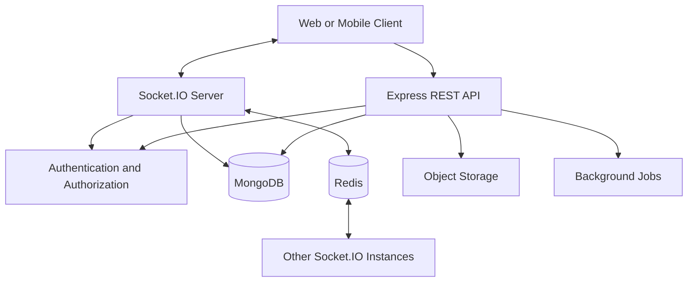

# Real-Time Chat and Collaboration Platform

A scalable, real-time messaging application inspired by Slack, built with Node.js, Express.js, Socket.IO, MongoDB, and Redis. The platform enables users to communicate through private conversations and group chats with real-time messaging, online presence, typing indicators, read receipts, and secure file sharing.

## 🚀 Features

- **Authentication & Authorization** — Secure registration, login, JWT authentication, and role-based access control.
- **One-to-One Messaging** — Send and receive private messages instantly.
- **Group Chats & Channels** — Create groups, manage members, and control access.
- **Real-Time Communication** — Use Socket.IO for instant messaging and live updates.
- **Online Presence** — Track online/offline status and last-seen information.
- **Typing Indicators** — See when another user is typing.
- **Read Receipts** — Track message delivery and read status.
- **File Sharing** — Share images and documents securely.
- **Message Search** — Search messages with filters and pagination.
- **Redis Integration** — Support real-time communication across multiple server instances.
- **Notifications** — Notify users about messages and relevant activity.
- **API Documentation** — Document REST APIs using Swagger/OpenAPI.
- **Testing & Deployment** — Automated tests, Docker support, and CI/CD.

## 🛠️ Tech Stack

| Technology | Purpose |
|---|---|
| Node.js | JavaScript runtime |
| Express.js | REST API framework |
| Socket.IO | Real-time bidirectional communication |
| Postgres| Persistent database |
| Postgres |
| Redis | Socket scaling, caching, and temporary presence |
| JWT | Authentication |
| bcrypt | Password hashing |
| Zod / Joi | Request validation |
| Cloudinary / S3 | File storage |
| Swagger | API documentation |
| Jest / Vitest | Automated testing |
| Docker | Containerization |

## 🏗️ System Architecture



### How It Works

1. Users authenticate through the REST API.
2. The server verifies credentials and issues authentication tokens.
3. Clients establish authenticated Socket.IO connections.
4. Messages are authorized and persisted in MongoDB.
5. Socket.IO broadcasts message events to authorized recipients.
6. Redis enables event broadcasting between multiple server instances.
7. Clients reconnecting after network interruptions synchronize missed messages from persistent storage.

**Important:** MongoDB stores permanent messages. Redis supports temporary state and cross-instance communication; it is not the permanent source of truth for messages.

## 📁 Project Structure

```text
real-time-chat/
├── src/
│   ├── config/
│   ├── modules/
│   │   ├── auth/
│   │   ├── users/
│   │   ├── conversations/
│   │   ├── messages/
│   │   ├── channels/
│   │   ├── attachments/
│   │   └── notifications/
│   ├── sockets/
│   │   ├── handlers/
│   │   └── middleware/
│   ├── middlewares/
│   ├── services/
│   ├── repositories/
│   ├── validators/
│   ├── jobs/
│   ├── utils/
│   ├── app.js
│   └── server.js
├── tests/
├── .github/
│   └── workflows/
├── .env.example
├── .gitignore
├── Dockerfile
├── docker-compose.yml
├── package.json
└── README.md
```

*The structure may evolve as development progresses.*

## ⚙️ Getting Started

### Prerequisites

Install the following tools:

- Node.js 20 or later
- npm
- MongoDB
- Redis
- Git

Alternatively, use Docker Compose for local database and Redis services.

### 1. Clone the Repository

```bash
git clone <YOUR_GITHUB_REPOSITORY_URL>
cd real-time-chat
```

Replace the placeholder with your actual GitHub repository URL.

### 2. Install Dependencies

```bash
npm install
```

### 3. Configure Environment Variables

Create a `.env` file in the project root using `.env.example` as a template.

Example:

```env
NODE_ENV=development
PORT=5000

MONGODB_URI=mongodb://localhost:27017/realtime_chat
REDIS_URL=redis://localhost:6379

JWT_ACCESS_SECRET=replace_with_a_secure_random_secret
JWT_REFRESH_SECRET=replace_with_another_secure_random_secret

CLIENT_URL=http://localhost:3000

# Configure file storage credentials when needed
CLOUDINARY_CLOUD_NAME=
CLOUDINARY_API_KEY=
CLOUDINARY_API_SECRET=
```

Generate strong secrets for local development. Never commit `.env` or production credentials to GitHub.

### 4. Start MongoDB and Redis

If MongoDB and Redis are installed locally, start both services.

If Docker Compose is configured:

```bash
docker compose up -d
```

### 5. Start the Application

Use the scripts defined in your `package.json`. For example, if these scripts are configured:

```bash
npm run dev
```

For production:

```bash
npm start
```

The API will be available at:

```text
http://localhost:5000
```

The actual port, scripts, and endpoints depend on your implementation.

## 🔌 API Endpoints

The following are planned endpoint examples.

| Method | Endpoint | Description |
|---|---|---|
| POST | `/api/v1/auth/register` | Register a user |
| POST | `/api/v1/auth/login` | Log in |
| POST | `/api/v1/auth/refresh` | Refresh authentication tokens |
| POST | `/api/v1/auth/logout` | Log out |
| GET | `/api/v1/users/me` | Get current user |
| PATCH | `/api/v1/users/me` | Update user profile |
| POST | `/api/v1/conversations` | Create a conversation |
| GET | `/api/v1/conversations` | List conversations |
| GET | `/api/v1/conversations/:id/messages` | Retrieve conversation messages |
| POST | `/api/v1/conversations/:id/messages` | Send a message |
| PATCH | `/api/v1/messages/:id` | Edit a message |
| DELETE | `/api/v1/messages/:id` | Delete a message |
| GET | `/api/v1/search/messages?q=hello` | Search messages |

These endpoints are examples, not a claim that all routes are already implemented.

## ⚡ Socket.IO Events

### Client-to-Server Events

| Event | Description |
|---|---|
| `message:send` | Send a message |
| `message:read` | Mark messages as read |
| `typing:start` | Notify others that typing has started |
| `typing:stop` | Notify others that typing has stopped |
| `conversation:join` | Join an authorized conversation room |
| `conversation:leave` | Leave a conversation room |

### Server-to-Client Events

| Event | Description |
|---|---|
| `message:new` | Receive a new message |
| `message:delivered` | Receive a delivery acknowledgment |
| `message:read` | Receive a read receipt |
| `typing:update` | Receive typing status updates |
| `presence:update` | Receive online/offline status updates |
| `notification:new` | Receive a notification |

All event names and payloads should remain consistent between the client and server. The server must verify authentication and conversation permissions before processing events.

## 🧪 Testing

Run the commands configured in your project scripts. A typical setup might use:

```bash
npm test
```

Test coverage should include:

- Authentication and authorization.
- Message creation and persistence.
- Private conversation access.
- Group membership permissions.
- Socket.IO message delivery.
- Read receipts and typing indicators.
- Duplicate-message prevention.
- Redis adapter behavior across server instances.
- Input validation and rate limiting.
- File upload security.

## 🔐 Security

- Hash passwords using bcrypt.
- Validate all incoming requests and socket payloads.
- Verify JWTs and enforce token expiration.
- Apply authorization checks to every private conversation.
- Rate-limit authentication and messaging endpoints.
- Validate file types, sizes, and access permissions.
- Configure CORS and secure HTTP headers.
- Keep secrets in environment variables.
- Use structured logging without exposing sensitive information.

## 📈 Scalability and Reliability

The architecture is designed to support future scaling through:

- Horizontal scaling of Node.js instances.
- Redis adapter for cross-instance Socket.IO events.
- Indexed database queries and cursor-based pagination.
- Temporary presence data with expiration.
- Reconnection handling and message history synchronization.
- Background jobs for asynchronous notifications.
- Health checks, logging, and automated tests.

Delivery guarantees, retry behavior, and message synchronization must be implemented and tested explicitly.

## 🚢 Deployment

The application can be deployed using Docker and a hosting provider that supports persistent connections and WebSockets.

Typical deployment requirements include:

1. Configure production environment variables.
2. Provision managed MongoDB and Redis services.
3. Deploy the Node.js application.
4. Configure the frontend origin and CORS.
5. Verify WebSocket connectivity.
6. Configure health checks and application logs.
7. Run automated tests before releasing changes.

## 🗺️ Development Roadmap

- [ ] Project setup and architecture
- [ ] Authentication and user profiles
- [ ] Private conversations
- [ ] Group chats and channels
- [ ] Persistent messaging
- [ ] Socket.IO integration
- [ ] Typing indicators and online presence
- [ ] Message delivery and read receipts
- [ ] Redis adapter and multi-instance testing
- [ ] File sharing and message search
- [ ] Notifications
- [ ] Automated tests
- [ ] Docker and CI/CD
- [ ] Production deployment

## 🎯 Learning Outcomes

This project demonstrates practical knowledge of:

- REST API development with Express.js.
- Real-time communication using Socket.IO.
- Database modeling and query optimization.
- Authentication and authorization.
- Redis and horizontal scaling.
- Distributed-system reliability concepts.
- Automated testing and deployment.
- Backend architecture and system design.

## 🤝 Contributing

Contributions, suggestions, and bug reports are welcome.

1. Fork the repository.
2. Create a feature branch.
3. Commit your changes.
4. Open a pull request with a clear description.

## 📄 License

Choose a license appropriate for your project, such as the MIT License, and add the corresponding `LICENSE` file if you want to distribute the code under that license.

---

**Status:** In development

Built to explore real-time systems, scalable backend architecture, and production-oriented engineering practices.
